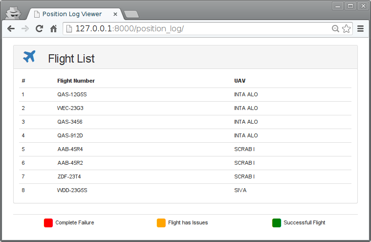

============================
Carga síncrona con AngularJS
============================

En este ejemplo utilizamos AngularJS para generar una tabla en el lado del cliente a partir de unos datos contenidos estáticamente en la página. Dicho contenido es generado por una plantilla en el backend por Django.

Modelos
=======

[``prj/eventlog/models.py``]

.. literalinclude:: ../070-angular-sync/prj/eventlog/models.py
   :linenos:

URLS
====

[``prj/prj/urls.py``]

.. literalinclude:: ../070-angular-sync/prj/prj/urls.py
   :lines: 16-

[``prj/eventlog/urls.py``]

.. literalinclude:: ../070-angular-sync/prj/eventlog/urls.py

Vistas
======

[``prj/eventlog/views.py``]

.. literalinclude:: ../070-angular-sync/prj/eventlog/views.py
   :linenos:

Plantillas
==========

La vista anterior muestra esta página:

[``prj/eventlog/templates/base.html``]

.. literalinclude:: ../070-angular-sync/prj/eventlog/templates/base.html
   :language: html
   :linenos:

Se crean dos controladores AngularJS. ``LegendCtrl`` simplemente proporciona los colores y significado de una leyenda. Al fijarse como una propiedad del ``$scope``, está disponible para generarla bajo la tabla de vuelos.

El controlador hace algo similar con la lista de vuelos. La diferencia es que esta lista ha sido generada por el backend mediante una plantilla Django.

Destacar:

* La lista de vuelos ( ``flights``) que procesa Django en la lína 12.
* Los elementos del DOM que tienen asociados los controladores AngularJS
* La directiva ``ng-repeat`` en la línea 56 para generar la tabla

[``prj/eventlog/templates/list.html``]

.. literalinclude:: ../070-angular-sync/prj/eventlog/templates/list.html
   :language: html
   :linenos:

JavaScript
==========

Tanto el lenguaje de plantillas de Django como angular utilizan las llaves "{}" para sus expresiones y directivas. Para que puedan convivir optamos por indicar a AngularJS que utilice corchetes en lugar de llaves.

[``prj/eventlog/static/js/app.js``]

.. literalinclude:: ../070-angular-sync/prj/eventlog/static/js/app.js
   :language: js
   :linenos:

Ejercicio
=========

* Añadir soporte para filtrado: cuando el usuario pulsa sobre un UAV, solo se verán sus vuelos. El UAV se envía como parámetro GET al servidor, que restringirá la consulta a la BD para ese UAV.
