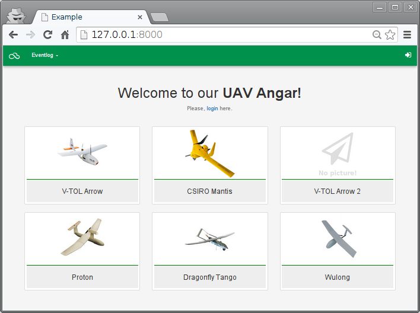
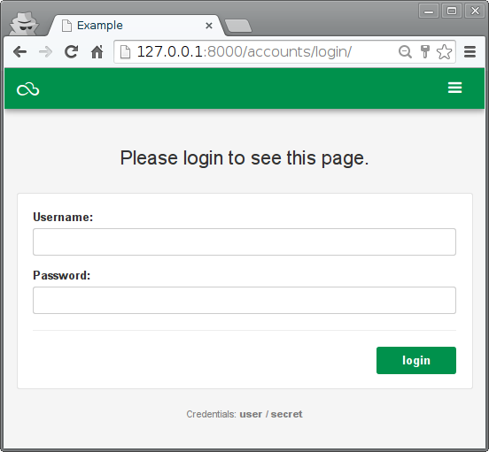

===============================
Autenticación básica con Django
===============================

Este ejemplo incluye los siguientes cambios relevantes respecto al anterior:

* Incluye una aplicación adicional llamada "home" que será accesible para cualquier usuario y que muestra fotos de los UAV disponibles.
* Se modifican las vistas anteriores para impedir su uso si no es con un usuario autenticado.
* Se incluyen las URI para las operaciones de autenticación.

La aplicación "home" debe ser incluida en el fichero ``settings.py``::

  INSTALLED_APPS = (
      'django.contrib.auth',
      'django.contrib.contenttypes',
      'django.contrib.sessions',
      'django.contrib.messages',
      'django.contrib.staticfiles',

      'eventlog',
      'home',
  )

Aspecto de la aplicación "home":

Modelos
=======

(Sin cambios)

[``prj/eventlog/models.py``]

.. literalinclude:: ../120-basic-auth/prj/eventlog/models.py
   :linenos:

URLS
====

Se incluye la URI *accounts* en el proyecto para la gestión de la autenticación.

[``prj/prj/urls.py``]

.. literalinclude:: ../120-basic-auth/prj/prj/urls.py
   :lines: 16-

[``prj/eventlog/urls.py``]

.. literalinclude:: ../120-basic-auth/prj/eventlog/urls.py

[``prj/home/urls.py``]

.. literalinclude:: ../120-basic-auth/prj/home/urls.py

Vistas
======

Las vistas incluyen las restricciones de autenticación mediante el decorador ``@login_required``, que se puede aplicar a peticiones convencionales (``index``) y peticiones AJAX (``insert`` y ``get_dataset``). En el caso del WebSocket se hace una comprobación explícita en el método de conexión.

[``prj/eventlog/views.py``]

.. literalinclude:: ../120-basic-auth/prj/eventlog/views.py
   :linenos:

[``prj/home/views.py``]

.. literalinclude:: ../120-basic-auth/prj/home/views.py
   :linenos:

Gestión básica de usuarios
==========================

Creación de un administrador::

  $ manage.py createsuperuser --username=admin --email=admin@example.com

Cambio de una contraseña::

  $ manage.py changepassword user

Plantillas
==========

Como las aplicaciones "eventlog" y "home" comparten el mismo estilo, la plantilla ``base.html`` se coloca en un lugar común a las dos: el directorio ``prj``, y debe indicarse en la configuración como un directorio donde buscar plantillas en ``settings.py``::

  TEMPLATES = [
      {
      ...
         'DIRS': [os.path.join(BASE_DIR, "templates")],
      ...

[``prj/templates/base.html``]

.. literalinclude:: ../120-basic-auth/prj/templates/base.html
   :language: html
   :linenos:
   :end-before: <!--

[``prj/eventlog/templates/eventlog.html``]

.. literalinclude:: ../120-basic-auth/prj/eventlog/templates/eventlog.html
   :language: html
   :linenos:
   :end-before: <!--

La aplicación de gestión de usuarios requiere una plantilla para el login:

[``prj/templates/registration/login.html``]

.. literalinclude:: ../120-basic-auth/prj/templates/registration/login.html
   :language: html
   :linenos:
   :end-before: <!--

Partials
--------

.. image:: figures/angular-async.png

[``prj/eventlog/static/js/eventlog/partials/list.html``]

.. literalinclude:: ../120-basic-auth/prj/eventlog/static/eventlog/partials/list.html
   :language: html
   :linenos:
   :end-before: <!--

.. image:: figures/insert-new-flight.png

[``prj/eventlog/static/eventlog/partials/insert.html``]

.. literalinclude:: ../120-basic-auth/prj/eventlog/static/eventlog/partials/insert.html
   :language: html
   :linenos:
   :end-before: <!--

JavaScript
==========

[``prj/eventlog/static/eventlog/js/app.js``]

.. literalinclude:: ../120-basic-auth/prj/eventlog/static/eventlog/js/app.js
   :language: js
   :linenos:

[``prj/eventlog/static/eventlog/js/controllers.js``]

.. literalinclude:: ../120-basic-auth/prj/eventlog/static/eventlog/js/controllers.js
   :language: js
   :linenos:

Gunicorn
========

Para poder utilizar WebSocket Django debe ejecutarse con un servidor de WSGI. Por ese motivo se utiliza ``Gunicorn``. El modo más sencillo es crear el siguiente fichero:

[``prj/wsgi.py``]

.. literalinclude:: ../120-basic-auth/prj/prj/wsgi.py
   :linenos:

El servidor se ejecuta con::

  $ gunicorn --reload -k prj.wsgi.Worker prj.wsgi

Ejercicio
=========

* Mostrar en todo momento el nombre del usuario logeado.
* Incluir un mecanismo para registrar nuevos usuarios (activación automática).
