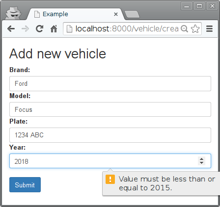

===================
Persistencia básica
===================

Este ejemplo muestra cómo crear un modelo para el ORM de Django. Mediante un formulario, el
usuario indicará los datos para crear una instancia de dicho modelo que quedará almacenada
en la base de datos.

La aplicación únicamente ofrece una ruta: ``/vehicle/create/``

[``prj/prj/urls.py``]

.. literalinclude:: ../040-basic-persistence/prj/prj/urls.py
   :lines: 16-

ORM: definición de los modelos
==============================

Se trata de un modelo muy sencillo para un concesionario de coches de segunda mano. Para
cada vehículo se almacena la marca (brand), modelo (model), matrícula (plate) y año de
matriculación (year).

Cada uno de esos campos (o columnas en la tabla de la base de datos) se modelan como un
atributo de la clase ``Vehicle``, que debe heredar necesariamente de ``Model``.

[``prj/app/models.py``]

.. literalinclude:: ../040-basic-persistence/prj/app/models.py
   :linenos:

Cada tipo de campo (``Field``) determina el tipo de la columna que se utilizará en la base de datos y puede utilizarse para generar un formulario a la medida del modelo, como veremos más adelante.

Exiten muchos `tipos de campos <https://docs.djangoproject.com/en/1.8/ref/models/fields/#model-field-types>`_ y también es posible `crear otros a medida <https://docs.djangoproject.com/en/1.8/howto/custom-model-fields/>`_.

Generación de formularios
=========================

En esta ocasión, en lugar de escribir desde cero el formulario, utilizaremos la clase
``Form`` de Django.  Este formulario ayuda a generar el código HTML necesario, y tiene la
ventaja de poder aplicar restricciones sobre los valores de los campos (habitualmente
denominado *validación*):

[``prj/app/forms.py``]

.. literalinclude:: ../040-basic-persistence/prj/app/forms.py
   :linenos:

Observe que los parámetros ``min_value`` y ``max_value`` (línea 20) permiten validar el
rango de años permitidos en el lado del servidor, mientras que los atributos ``min`` y
``max`` que se aplicarán en el HTML generado permiten hacer la misma validación en el
cliente (línea 11).

Plantillas jerárquicas
======================

En este ejemplo usamos plantillas jerárquicas. Esto es una características esencial dado
que no queremos repetir todos los elementos comunes en todas las plantillas. El fichero
``base.html`` define 3 bloques:

* title
* head
* content

Las plantillas que hereden de ésta podrán redefinir únicamente los bloques que sea
necesario, pero heredarán el resto de la plantilla.

[``prj/app/templates/base.html``]

.. literalinclude:: ../040-basic-persistence/prj/app/templates/base.html
   :linenos:
   :language: html
   :end-before: <!--

La plantilla ``vehicle-edit.html`` hereda de ``base.html`` y redefine el bloque
``content``. La plantilla incluye un aviso si el elemento ``added`` está definido. Observe
el condicional en la línea 5. El formulario generado por Django se coloca substituyendo {{
form }}.

[``prj/app/templates/vehicle-edit.html``]

.. literalinclude:: ../040-basic-persistence/prj/app/templates/vehicle-edit.html
   :linenos:
   :language: html

Vistas
======

Como se ha indicado, la aplicación incluye una única vista (función ``vehicle_create()``),
que se comporta de modo diferente si se invoca con POST o con GET.

* Si se invoca con GET devuelve la plantilla con el formulario vacío.

* Si se invoca con POST (es lo que hace el formulario) y los datos son válidos, crea una instancia del modelo y la guarda.

Éste es un patrón habitual.

[``prj/app/views.py``]

.. literalinclude:: ../040-basic-persistence/prj/app/views.py
   :linenos:

Makefile
========

.. literalinclude:: ../040-basic-persistence/Makefile
   :language: make

Tests
=====

.. literalinclude:: ../040-basic-persistence/prj/app/tests.py

Uso offline del ORM
===================

.. literalinclude:: ../exercises/040-basic-persistence/prj/offline-db.py

Ejercicios
==========

* Añade un método ``__unicode__`` a la clase ``Vehicle`` para que sus instancias sean **repr**-esentables.
* Crea una nueva vista que liste todos los vehículos almacenados en la base de datos

..
   Local Variables:
   mode: visual-line
   End:
