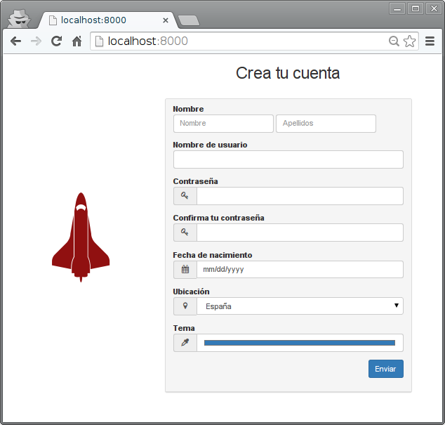

=========================
Formularios con bootstrap
=========================

`Twitter Bootstrap <http://getbootstrap.com/>`_ permite aplicar estilos (temas) y crear widgets mediante CSS y JS. Además permite crear interfaces adaptables (*responseve*).

.. image:: https://upload.wikimedia.org/wikipedia/commons/e/e7/Diseno-web-responsive-design.jpg
   :target: https://es.wikipedia.org/wiki/Dise%C3%B1o_web_adaptable

[``prj/prj/urls.py``]

.. literalinclude:: ../030-bootstrap-forms/prj/prj/urls.py
   :lines: 16-

Vistas
======

En este caso la vista que trata el formulario realiza una comprobación (coincidencia en
las contraseñas) y muestra los datos del formulario en la plantilla ``profile.html``

[``prj/app/views.py``]

.. literalinclude:: ../030-bootstrap-forms/prj/app/views.py

.. warning::

   De nuevo estas vistas no cumplen el patrón `Post/Redirect/Get
   <https://en.wikipedia.org/wiki/Post/Redirect/Get>`_. La vista que ha recibido el POST
   es la que devuelve la página con la representación del "perfil" de usuario. Eso
   significa que se el usuario recarga la página resultante enviará un nuevo POST. Lo
   arreglaremos en el ejercicio.

Plantillas
==========

La siguiente plantilla (``register.html``) corresponde al formulario. La sección
<head> incluye los CDN para bootstrap y jquery. El elemento <style> incluye únicamente CSS.

[``prj/app/templates/register.html``]

.. literalinclude:: ../030-bootstrap-forms/prj/app/templates/register.html
   :language: html
   :end-before: <!--

GRID system
-----------

Bootstrap ofrece un sistema de columnas que permite organizar el contenido de modo que
puedan aprovecharse sus posibilidades de adaptabilidad. Esta es una versión resumida de la página:

.. code-block:: html

    

      <form method="POST" action="/profile/">

        

	  
 LOGO 

	  
 

        

      </form>
    

Esto implica una fila (row) con dos columnas con anchuras de 4/12 y 8/12 en dispositivos
pequeños (small: sm). Para Bootstrap existen 4 tipos de pantallas:

* extra small (xs) <768px
* small (sm) >=768px
* medium (md) >=992px
* large  (lg) >=1200px

El posible especificar proporciones diferentes para tamaños de pantalla diferentes:

.. code-block:: html

  

    

      
 A 

      
 B 

    

  

De este modo las columnas tendrán la proporción 4 y 8 en dispositivos pequeños (como un
tablet), pero para dispositivos medium (o mayores) las columnas tendrán el mismo ancho.

Puede ver unos ejemplos de este sistema en http://getbootstrap.com/examples/grid/

Formulario
----------

El formulario también está formateado con Bootstrap. Veamos una versión resumida:

.. code-block:: html

  <form method="POST" action="/profile/">
    

      

        <input class="form-control" type="text" name="firstname"/>
        <input class="form-control" type="text" name="lastname"/>
      

    

    

      <input class="form-control" type="text" name="username"/>
    

    

      <input class="form-control" type="password" name="password"/>
    

    

      <input class="form-control" type="password" name="confirm-password"/>
    

    

      <input class="form-control" type="date" name="birth_date" />
    

    

      <select class="form-control" name="location">
        <option value="spain">España</option>
        <option value="france">Francia</option>
        <option value="portugal">Portugal</option>
      </select>
    

    

      <input class="form-control" type="color" value="#337AB7" name="color"/>
    

    

      <input class="btn btn-primary" type="submit" value="Enviar"/>
    

La clase ``form-group`` se utiliza para incluir la etiqueta y el widget de entrada en el
mismo elemento. La clase ``form-control`` formatea todos los widgets con un estilo
consistente:

.. code-block:: html

  

    <b>Nombre de usuario</b>
    <input class="form-control" type="text" required name="username" />
  

Otra clase interesante es ``input-group``. Es este caso se utiliza para colocar un icono
en la misma entrada (*input*):

.. code-block:: html

  

    
<i class="fa fa-fw fa-key"></i>

    <input class="form-control" type="password" required name="confirm-password" />
  

El icono se introduce gracias a la fuente [`awesome
<http://fortawesome.github.io/Font-Awesome/>`_]. Las clases "fa fa-fw fa-key" significan
"font awesome" (fa), "fixed width" (fa-fw) y el icono de la llave (fa-key) para la entrada
de la contraseña.

Esta segunda plantilla muestra los datos recibidos. La cadenas como {{ firstname }} son
variables que se substituyen por el valor del contexto de la plantilla que coincida.

[``prj/app/templates/profile.html``]

.. literalinclude:: ../030-bootstrap-forms/prj/app/templates/profile.html
   :language: html
   :end-before: <!--

Tests
=====

El siguiente fichero incluye un par de pruebas.

* La prueba ``test_form_is_processed`` comprueba que los valores de entrada del formulario aparecen en la página generada, aunque sin comprobar un orden o situación específico.

* La prueba ``test_form_passwords_mismatch`` comprueba que la página muestra un mensaje de error cuando las contraseñas no coinciden.

[``prj/app/test.py``]

.. literalinclude:: ../030-bootstrap-forms/prj/app/tests.py
   :language: python

Ejercicios
==========

#. Crea un grid con Bootstrap para comprobar como se adapta automáticamente al redimensionar el navegador.

#. Aplicando el patrón Post/Redirect/Get al ejemplo, crea 3 vistas:

   * Una vista que muestra un formulario de login (ruta ``/``). El formulario hace POST sobre la misma ruta.
   * Si el login tiene éxito redirige a la vista ``/profile/<username>`` que muestra los datos del usuario.
   * Una vista ``/register/`` que muestra un formulario de registro. El formulario hace POST sobre la mima vista.
   * Si tiene éxito redirige a la vista ``/``.
