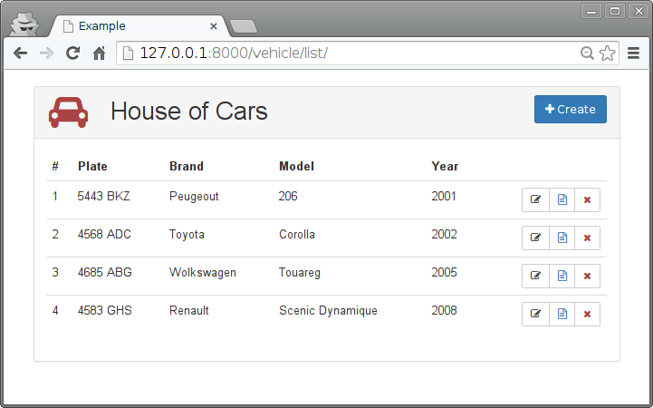
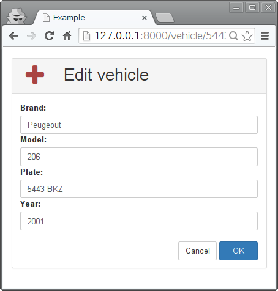

====
CRUD
====

`CRUD <https://es.wikipedia.org/wiki/CRUD>`_ es el acrónimo de Create, Read, Update and
Delete, las operaciones típicas de persistencia intimamente relacionadas con los SGBD
(Sistema Gestor de Base de Datos).

El programador debería primar las necesidades de la aplicación y evitar que CRUD domine
el diseño, aunque es algo que ocurre a menudo. En esta aplicación se han añadido vistas
para listar, editar y borrar. Y una vista adicional para generar un fichero de texto plano
con la información de una instancia.

[``prj/prj/urls.py``]

.. literalinclude:: ../050-crud/prj/prj/urls.py
   :lines: 16-

Modelos
=======

El modelo se ha cambiado para que la matrícula no sea la clave primaria.

[``prj/app/models.py``]

.. literalinclude:: ../050-crud/prj/app/models.py

Formularios
===========

Sin cambios respecto al ejemplo anterior.

[``prj/app/forms.py``]

.. literalinclude:: ../050-crud/prj/app/forms.py

Vistas
======

[``prj/app/views.py``]

.. literalinclude:: ../050-crud/prj/app/views.py
   :linenos:

Plantillas
==========

[``prj/app/templates/base.html``]

.. literalinclude:: ../050-crud/prj/app/templates/base.html
   :language: html
   :end-before: <!--

[``prj/app/templates/vehicle-list.html``]

.. literalinclude:: ../050-crud/prj/app/templates/vehicle-list.html
   :language: html
   :end-before: <!--

[``prj/app/templates/vehicle-edit.html``]

.. literalinclude:: ../050-crud/prj/app/templates/vehicle-edit.html
   :language: html
   :end-before: <!--

[``prj/app/templates/vehicle-file.html``]

.. literalinclude:: ../050-crud/prj/app/templates/vehicle-file.html
   :language: html
   :end-before: <!--

Fixtures
========

Cuando se quieren realizar pruebas (tanto manuales como automáticas) es conveniente
disponer de contenido precargado (fixtures) en la base de datos. Django puede cargar datos
en la base de datos desde diversos formatos. En este ejemplo se utiliza JSON:

.. literalinclude:: ../050-crud/prj/app/sample_data.json

Para cargarlo ejecuta::

  prj$ ./manage.py loaddata app/sample_data.json

Tests
=====

.. literalinclude:: ../050-crud/prj/app/tests.py

Ejercicio
=========

* Añade un nuevo modelo ``Brand``. Añade una vista para crear *marcas*. Utiliza ese nuevo modelo con ``ForeignKey`` en el campo ``Vehicle.brand``.
