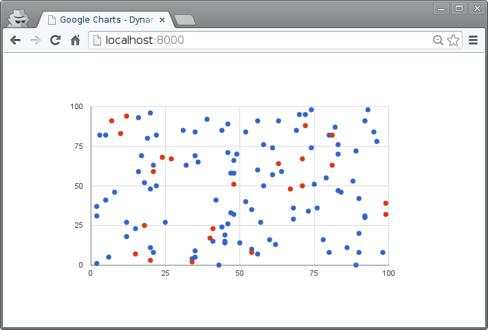

=========================================
Google Charts con actualización asíncrona
=========================================

Este ejemplo muestra cómo incluir información adicional en un gráfico existente.

Vistas
======

[``prj/app/views.py``]

.. literalinclude:: ../140-google-charts-dynamic/prj/app/views.py
   :linenos:

Plantillas
==========

[``prj/app/templates/index.html``]

.. literalinclude:: ../140-google-charts-dynamic/prj/app/templates/index.html
   :language: html
   :end-before: <!--

JavaScript
==========

.. literalinclude:: ../140-google-charts-dynamic/prj/app/static/js/app.js
   :language: js
   :linenos:

Ejercicio
=========

* Obtener los datos nuevos desde el servidor (polling o websockets) en lugar de generarlos en el frontend.
