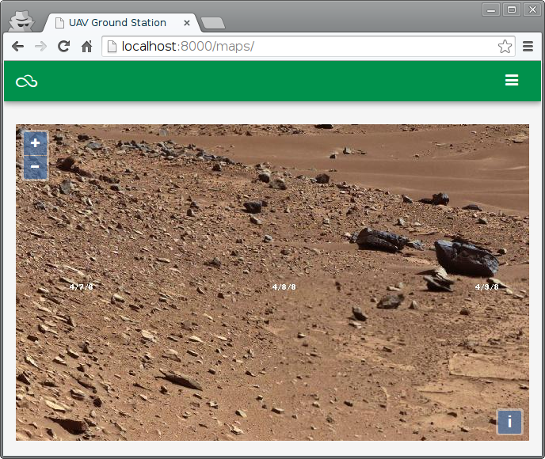

==========
OpenLayers
==========

Este ejemplo añade una nueva aplicación Django que demuestra el uso de OpenLayers para crear una imagen teselada con zoom de varios niveles.

URLS
====

[``prj/prj/urls.py``]

.. literalinclude:: ../150-open-layers/prj/prj/urls.py
   :lines: 16-

[``prj/maps/urls.py``]

.. literalinclude:: ../150-open-layers/prj/maps/urls.py

Vistas
======

[``prj/maps/views.py``]

.. literalinclude:: ../150-open-layers/prj/maps/views.py
   :linenos:

Plantillas
==========

[``prj/templates/base.html``]

.. literalinclude:: ../150-open-layers/prj/templates/base.html
   :language: html
   :linenos:
   :end-before: <!--

[``prj/maps/templates/maps.html``]

.. literalinclude:: ../150-open-layers/prj/maps/templates/maps.html
   :language: html
   :linenos:
   :end-before: <!--

JavaScript
==========

[``prj/maps/static/maps/js/app.js``]

.. literalinclude:: ../150-open-layers/prj/maps/static/maps/js/app.js
   :language: js
   :linenos:
