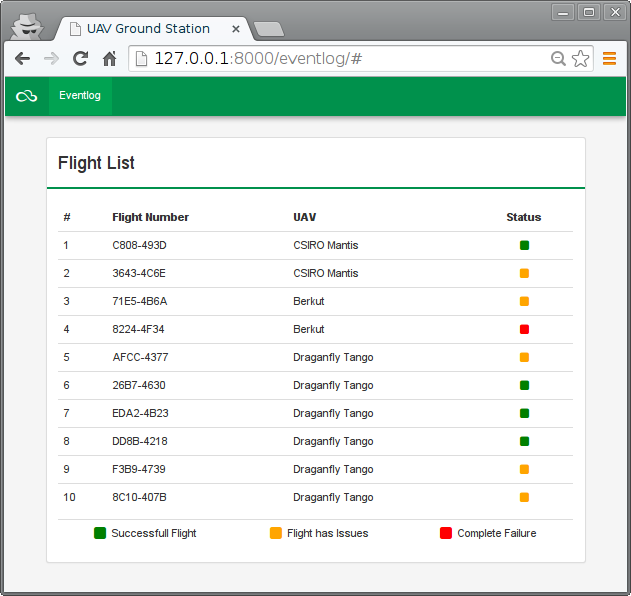
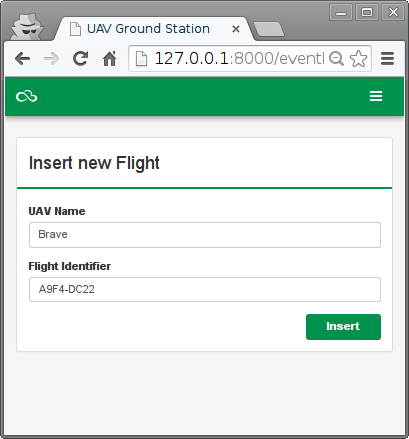

===========
Server push
===========

Este ejemplo muestra cómo utilizar UN WebSocket para que el servidor pueda informar de nuevos vuelos de forma asíncrona. De ese modo el cliente no necesita hacer una consulta periódica para detectar cambios en el modelo remoto. De este modo se ahorran recursos tanto en el cliente como en el servidor.

* El servidor debe crear una vista para servir el websocket.
* El cliente debe obtener el websocket a partir de dicha URL.
* El cliente pone un manejador (ws.onmessage) para recibir los nuevos vuelos y los incluye directamente en el modelo del frontend. Es necesario ejecutar ``$apply`` para que los cambios se hagan efectivos.

Modelos
=======

[``prj/eventlog/models.py``]

.. literalinclude:: ../100-server-push/prj/eventlog/models.py
   :linenos:

URLS
====

[``prj/prj/urls.py``]

.. literalinclude:: ../100-server-push/prj/prj/urls.py
   :lines: 16-

[``prj/eventlog/urls.py``]

.. literalinclude:: ../100-server-push/prj/eventlog/urls.py

Vistas
======

[``prj/eventlog/views.py``]

.. literalinclude:: ../100-server-push/prj/eventlog/views.py
   :linenos:

Plantillas
==========

[``prj/eventlog/templates/base.html``]

.. literalinclude:: ../100-server-push/prj/eventlog/templates/base.html
   :language: html
   :linenos:
   :end-before: <!--

[``prj/eventlog/templates/eventlog.html``]

.. literalinclude:: ../100-server-push/prj/eventlog/templates/eventlog.html
   :language: html
   :linenos:
   :end-before: <!--

Partials
--------

[``prj/eventlog/static/js/eventlog/partials/list.html``]

.. literalinclude:: ../100-server-push/prj/eventlog/static/eventlog/partials/list.html
   :language: html
   :linenos:
   :end-before: <!--

[``prj/eventlog/static/eventlog/partials/insert.html``]

.. literalinclude:: ../100-server-push/prj/eventlog/static/eventlog/partials/insert.html
   :language: html
   :linenos:
   :end-before: <!--

JavaScript
==========

[``prj/eventlog/static/eventlog/js/app.js``]

.. literalinclude:: ../100-server-push/prj/eventlog/static/eventlog/js/app.js
   :language: js
   :linenos:

[``prj/eventlog/static/eventlog/js/controllers.js``]

.. literalinclude:: ../100-server-push/prj/eventlog/static/eventlog/js/controllers.js
   :language: js
   :linenos:

Gunicorn
========

Para poder utilizar WebSocket Django debe ejecutarse con un servidor de WSGI. Por ese motivo se utiliza ``Gunicorn``. El modo más sencillo es crear el siguiente fichero:

[``prj/wsgi.py``]

.. literalinclude:: ../100-server-push/prj/prj/wsgi.py
   :linenos:

El servidor se ejecuta con::

  $ gunicorn --reload -k prj.wsgi.Worker prj.wsgi

Ejercicio
=========

* Incluya soporte en la interfaz para eliminar vuelos.
* Notifique mediante push también la eliminación de vuelos, todos los clientes conectados deben ser notificados de los cambios.
