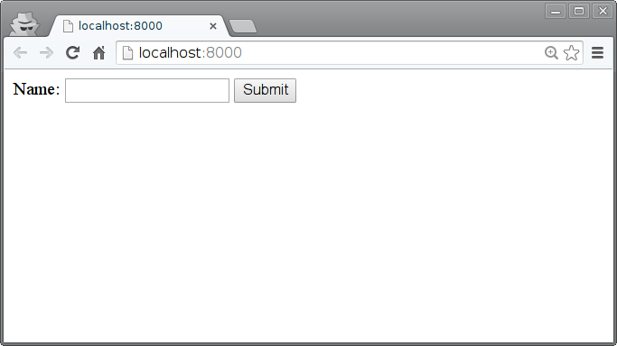

===========
Formularios
===========

Los formularios son la forma más habitual de llevar datos desde el cliente al servidor. Los formularios pueden utilizar el método GET o POST de HTTP.

Métodos HTTP
============

Los métodos o verbos HTTP incluyen una URI y algunos un contenido. Los más importantes son:

* GET: Para solicitar la representación de un recurso. No modifica nada en el servidor. Es cacheable.
* POST: Una modificación o añadido sobre un recurso existente. No es cacheable.
* HEAD: Como GET, pero solo devuelve las cabeceras, no el recurso en sí.
* PUT: Crea un nuevo recurso en el servidor.
* DELETE: Elimina el recurso indicado.
* OPTIONS: Permite averiguar qué métodos soporta el recurso.

Más información sobre GET y POST: http://www.w3schools.com/tags/ref_httpmethods.asp

.. note::

   Siempre que se añade una aplicación se debe "activar" en el fichero de configuración:

   [``prj/prj/settings.py``]

   ::

     INSTALLED_APPS = (
         'django.contrib.admin',
         'django.contrib.auth',
         'django.contrib.contenttypes',
         'django.contrib.sessions',
         'django.contrib.messages',
         'django.contrib.staticfiles',

         'app',
     )

La lista ``urlpatterns`` especifica el mapeo entre las URI permitidas por el servidor
(mediante expresiones regulares) y los controladores (llamados *vistas* en la nomenclatura
de Django).

[``prj/prj/urls.py``]

.. literalinclude:: ../025-simple-forms/prj/prj/urls.py
   :lines: 16-

En este ejemplo hay dos vistas:

* La vista ``index`` retorna una página que incluye el formulario, usando la plantilla
  ``simple-form.html``

* La vista ``print_form`` devuelve una página con el text "OK" y un comentario, e imprime
  el campo ``name`` recibido a través del formulario.

[``prj/app/views.py``]

.. literalinclude:: ../025-simple-forms/prj/app/views.py

.. warning::
   La vista ``print_form`` viola el patrón `Post/Redirect/Get
   <https://en.wikipedia.org/wiki/Post/Redirect/Get>`_ que dice que después de tratar un
   mensaje POST siempre se debe hacer una redirección.

   Problema:

   .. image:: https://upload.wikimedia.org/wikipedia/commons/f/f3/PostRedirectGet_DoubleSubmitProblem.png

   Solución:

   .. image:: https://upload.wikimedia.org/wikipedia/commons/3/3c/PostRedirectGet_DoubleSubmitSolution.png

[``prj/app/templates/simple-form.html``]

.. literalinclude:: ../025-simple-forms/prj/app/templates/simple-form.html
   :language: html

Para ejecutar la aplicación::

  prj$ ./manage.py runserver

Por último, un test automático sencillo que comprueba que el comentario del página incluye
el valor indicado en el formulario, lo que demuestra que la vista en el servidor se
ejecutó correctamente.

[``prj/app/tests.py``]

.. literalinclude:: ../025-simple-forms/prj/app/tests.py

Para ejecutar el test::

  prj$ ./manage.py test

Ejercicios
==========

1. Aplica el patrón Post/Redirect/Get al ejemplo, es decir:

   * La primera vista muestra el formulario (ruta /)
   * El formulario ejecuta POST a usa segunda vista (ruta /save), que almacena el contenido en memoria.
   * La vista anterior redirecciona a una tercera vista (ruta /show) que muestra los datos almacenados.
