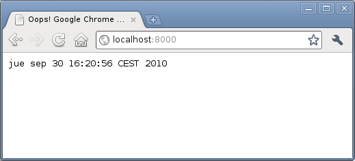
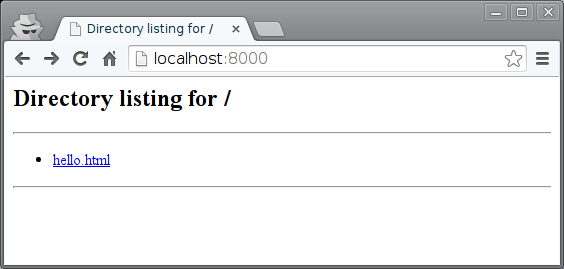
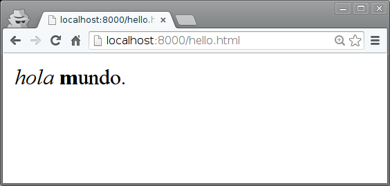
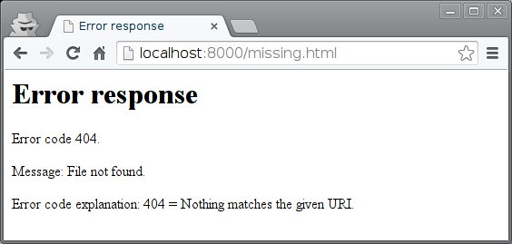

============
Servidor Web
============

Servidor TCP
============

Un servidor web esencialmente es un servidor TCP. Usemos ``ncat`` como servidor web
extremadamente rudimentario:

.. code-block:: sh

   $ ncat -l 8000

Y ``chromium`` como cliente (o cualquier otro navegador):

.. code-block:: sh

   $ chromium http://localhost:8000

Esto nos permite ver el mensaje que envía el navegador:

.. code-block:: sh
   :linenos:

   $ ncat -l 8000
   GET / HTTP/1.1
   Host: localhost:8000
   Connection: keep-alive
   Accept: text/html,application/xhtml+xml,application/xml;q=0.9,image/webp,*/*;q=0.8
   User-Agent: Mozilla/5.0 (X11; Linux x86_64) AppleWebKit/537.36 (KHTML, like Gecko) Chrome/43.0.2357.65 Safari/537.36
   DNT: 1
   Accept-Encoding: gzip, deflate, sdch
   Accept-Language: es,en-US;q=0.8,en;q=0.6

En este caso el programa ``ncat`` envía al cliente lo que lea por la entrada
estándar. Pero es posible indicarle que envíe la salida de un programa:

.. code-block:: sh

   $ ncat -k -l 8000 -c date

Aunque supuestamente el navegador debería consumir únicamente HTML (en este caso los tipos indicados en la cabecera "Accept") en realidad acepta y representa texto plano. Los navegadores web son en realidad extraordinariamente flexibles y robustos (quizá demasiado...).

Servidor HTTP
=============

Obviamente ``ncat`` puede servir para probar conectividad, pero poco más. No podemos crear una aplicación web sin un servidor capaz de manejar el protocolo HTTP.

El módulo ``SimpleHTTPServer`` permite crear servidores web específicos. El propio módulo se puede utilizar como un servidor web para listar (y servir) los ficheros del propio directorio.

El fichero ``hello.html`` contiene::

  <i>hola</i> <b>m</b>undo.

.. code-block: sh

   $ python -m SimpleHTTPServer
   Serving HTTP on 0.0.0.0 port 8000 ...

El log del servidor muestra los verbos, la ruta y el valor de retorno de cada petición::

  Serving HTTP on 0.0.0.0 port 8000 ...
  127.0.0.1 - - [11/Jul/2015 11:26:38] "GET / HTTP/1.1" 200 -
  127.0.0.1 - - [11/Jul/2015 11:26:42] "GET /hello.html HTTP/1.1" 200 -
  127.0.0.1 - - [11/Jul/2015 11:28:27] code 404, message File not found
  127.0.0.1 - - [11/Jul/2015 11:28:27] "GET /missing.html HTTP/1.1" 404 -

Veamos cómo crear nuestro propio servidor:

.. literalinclude:: ../005-simple-http-server/server.py
   :linenos:

Ejercicios
==========

* Modifica el código anterior de modo que ante  URL diferentes proporcione contenidos diferentes (``server-handlers.py``)..
* Modifica el código anterior de modo que responda a una petición POST que acepta un parámetro "name" (``server-post.py``). Pruébalo con el comando::

   $ curl --data "name=hola" http://localhost:8000/post
